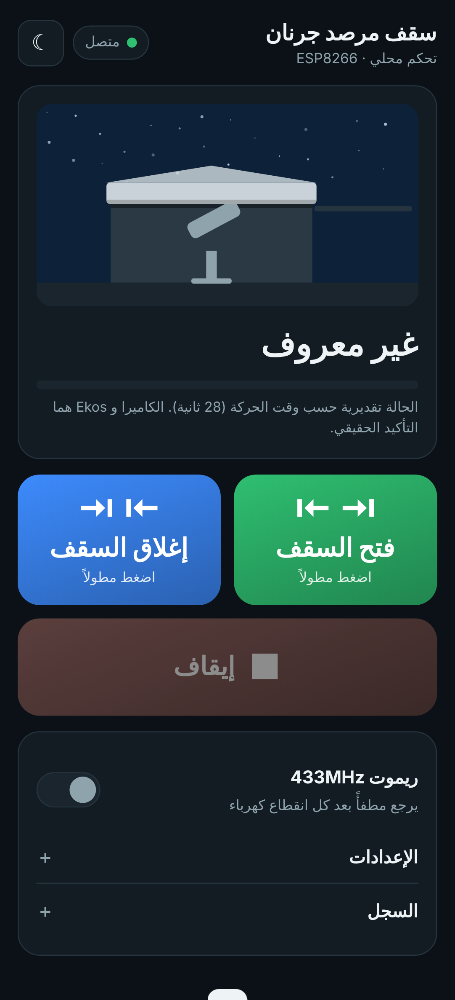
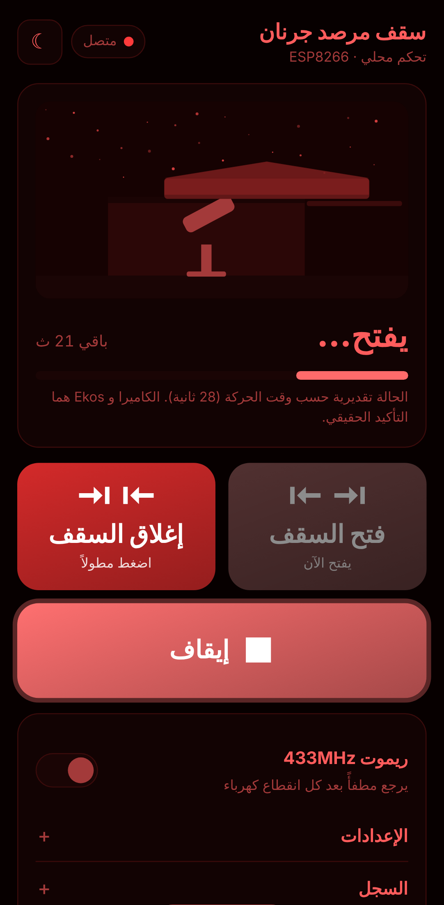
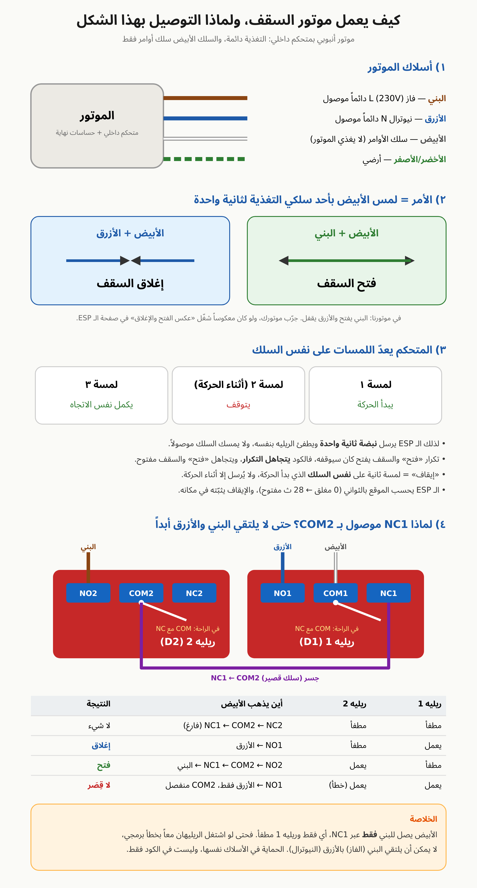
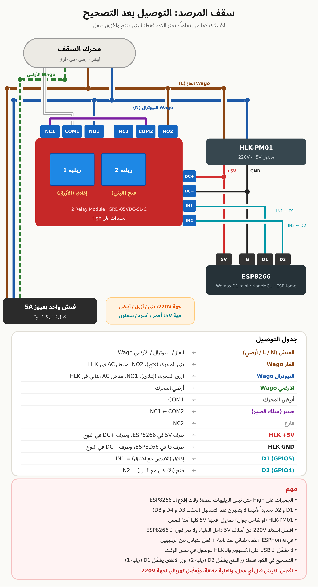
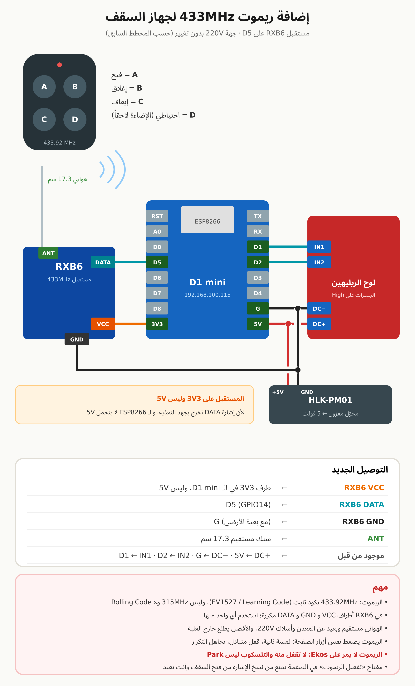

# Ekos Roof Controller

<div dir="rtl">

تحكم بسقف مرصد منزلق (Roll-off) من **Ekos / StellarMate** باستخدام **ESP8266** و**ESPHome**، مع لوحة ريليهين جاهزة، وصفحة تحكم عربية، وريموت 433MHz.

</div>

> Control a roll-off observatory roof from **Ekos / StellarMate** with an **ESP8266 (Wemos D1 mini)** running **ESPHome** and an off-the-shelf 2-channel relay module. Includes an Arabic web UI, a 433 MHz remote, and INDI *Dome Scripting Gateway* scripts. Built for Jarnan Observatory (Oman).

<p align="center">
 
</p>

---

<div dir="rtl">

## المميزات

- **Ekos يفتح السقف قبل Unpark ويقفله بعد Park**، عبر Dome Scripting Gateway.
- **أوامر منفصلة:** فتح، إغلاق، إيقاف. لا يوجد زر واحد يُخمَّن اتجاهه.
- **موقع السقف بالثواني:** الإيقاف في المنتصف يُحسب، والإغلاق بعده يأخذ الوقت الصحيح فقط. الموقع محفوظ بعد انقطاع الكهرباء.
- **حماية في الأسلاك:** البني والأزرق لا يلتقيان أبداً، حتى لو أخطأ الكود.
- **حماية في Ekos:** لا يُغلق السقف والتلسكوب غير Parked، ولا يتحرك التلسكوب والسقف مغلق.
- **صفحة عربية داخل الـ ESP:** أزرار كبيرة بالضغط المطوّل، ورسم متحرك للسقف، ووضع رصد ليلي أحمر، وتحديث البرنامج من المتصفح. تعمل بدون إنترنت.
- **ريموت 433MHz** (اختياري)، يعمل فقط بعد تفعيله من الصفحة، ويرجع مطفأً بعد انقطاع الكهرباء.

---

## كيف يعمل الموتور، ولماذا التوصيل بهذا الشكل

<p align="center"></p>

الموتور أنبوبي وفيه متحكم داخلي:

| السلك | الوظيفة |
|---|---|
| **البني** | فاز L (230V)، موصول دائماً |
| **الأزرق** | نيوترال N، موصول دائماً |
| **الأبيض** | سلك الأوامر فقط، لا يغذي الموتور |
| الأخضر/الأصفر | أرضي |

**الأمر = لمس الأبيض بأحد سلكي التغذية لثانية واحدة:**
- الأبيض + البني ← **فتح** (في موتورنا).
- الأبيض + الأزرق ← **إغلاق**.

**المتحكم يعدّ اللمسات على نفس السلك:** لمسة تبدأ الحركة، والثانية أثناء الحركة توقفه، والثالثة تكمل نفس الاتجاه. ولهذا:
1. الـ ESP يرسل **نبضة ثانية واحدة** ويطفئ الريليه بنفسه، حتى لو انقطع الواي فاي.
2. تكرار «فتح» والسقف يفتح كان سيوقفه، فالكود **يتجاهل التكرار**، ويتجاهل «فتح» والسقف مفتوح.
3. «إيقاف» لمسة ثانية على **نفس السلك** الذي بدأ الحركة، ولا يُرسل إلا أثناء الحركة.

**لماذا NC1 موصول بـ COM2؟** الأبيض يدخل COM1. ريليه 1 في الراحة يمرره إلى NC1 ثم إلى COM2، فلا يصل الأبيض إلى البني (NO2) إلا وريليه 1 **مطفأ**. حتى لو اشتغل الريليهان معاً بخطأ، يذهب الأبيض إلى الأزرق فقط، ويبقى COM2 منفصلاً، **فلا يمكن أن يلتقي الفاز بالنيوترال**.

> لو كان موتورك معكوساً (البني يقفل)، لا تغيّر الأسلاك: شغّل **«عكس الفتح والإغلاق»** في إعدادات الصفحة.

---

## القطع

| القطعة | ملاحظة |
|---|---|
| Wemos D1 mini (ESP8266) | |
| لوحة ريليهين 5V بأوبتوكبلر | نوع High/Low trigger، الجمبرات على **High** |
| مزوّد 5V معزول | HLK-PM01، أو شاحن جوال جيد |
| مستقبل RXB6 433MHz + ريموت EV1527 | اختياري، هوائي 17.3 سم |
| أسلاك وعلبة مغلقة | جهة 230V داخل العلبة |

## مخطط التوصيل

<p align="center"></p>

| D1 mini | إلى |
|---|---|
| 5V | DC+ في لوحة الريليهات، ومخرج 5V من المزوّد |
| G | DC− في لوحة الريليهات، وأرضي المزوّد |
| D1 (GPIO5) | IN1 ← ريليه 1 |
| D2 (GPIO4) | IN2 ← ريليه 2 |
| D5 (GPIO14) | DATA في مستقبل RXB6 (اختياري) |
| 3V3 | VCC في مستقبل RXB6 (وليس 5V) |

| لوحة الريليهات | إلى |
|---|---|
| COM1 | الأبيض |
| NO1 | الأزرق |
| NC1 | سلك قصير إلى COM2 |
| NO2 | البني |
| NC2 | فارغ |

<details><summary>مخطط الريموت 433MHz</summary>
<p align="center"></p>
</details>

---

## التركيب

1. **[رفع الكود على الـ ESP](docs/esp-upload.md):** تثبيت ESPHome، وملف secrets، والرفع الأول بـ USB، ثم التحديث عبر الشبكة.
2. **[إعداد StellarMate و Ekos](docs/stellarmate-setup.md):** نسخ السكربتات، والإعدادات، وخطوات Ekos، والـ Scheduler، وحل المشاكل.

## محتوى المستودع

| المجلد | المحتوى |
|---|---|
| `esphome/roof-controller.yaml` | كود الـ ESP |
| `esphome/roof_pos.h` | حساب موقع السقف بالثواني (لازم يكون بجانب الـ yaml) |
| `esphome/www/roof-ui.js` | الصفحة العربية (تُضمَّن داخل البرنامج) |
| `esphome/secrets.example.yaml` | مثال لكلمات السر، انسخه إلى `secrets.yaml` |
| `ekos/roof/` | سكربتات Dome Scripting Gateway لـ StellarMate |
| `diagrams/` | المخططات |

## واجهة HTTP

```bash
curl -u admin:PASS -X POST "http://192.168.100.115/button/Roof%20Open/press"
curl -u admin:PASS -X POST "http://192.168.100.115/button/Roof%20Close/press"
curl -u admin:PASS -X POST "http://192.168.100.115/button/Roof%20Stop/press"
curl -u admin:PASS "http://192.168.100.115/text_sensor/Roof%20State"   # open/closed/opening/closing/stopped/unknown
```

## الأمان

- **230V قاتل.** افصل الفيش قبل أي عمل، وشغّل والعلبة مغلقة، والأفضل أن يراجع كهربائي التوصيل.
- حالة السقف في الـ ESP **تقدير بالوقت**. للأمان الكامل أضف الكاميرا (`STATUS_SOURCE = "camera"`) أو حساسات نهاية مغناطيسية.
- لا تفتح منافذ الـ ESP على الإنترنت. للوصول عن بعد استخدم VPN مثل ZeroTier أو Tailscale.
- الريموت لا يمر عبر Ekos، فلا تقفل به والتلسكوب ليس Parked.
- `secrets.yaml` لا يُرفع للمستودع.

</div>
